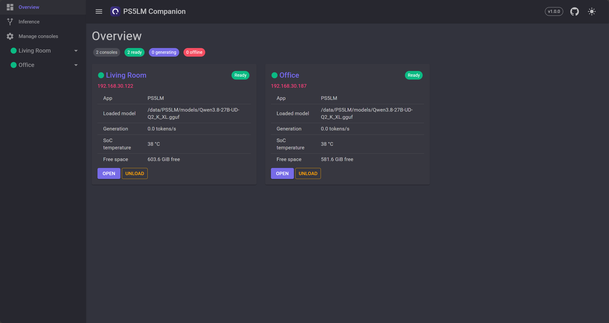
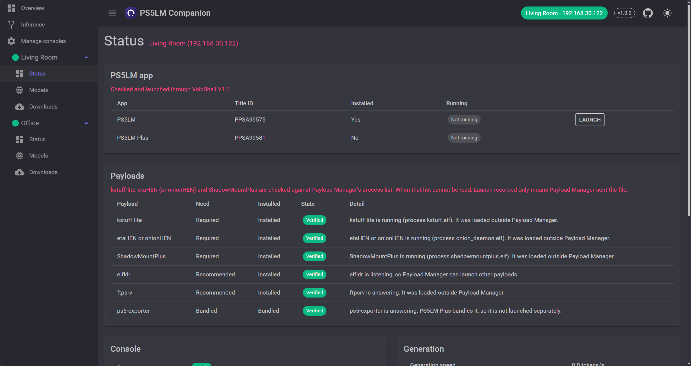
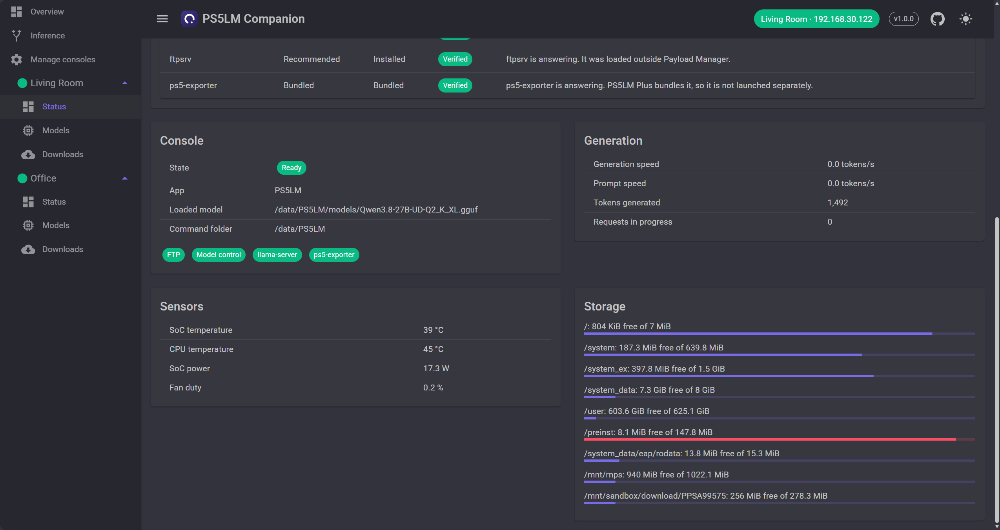
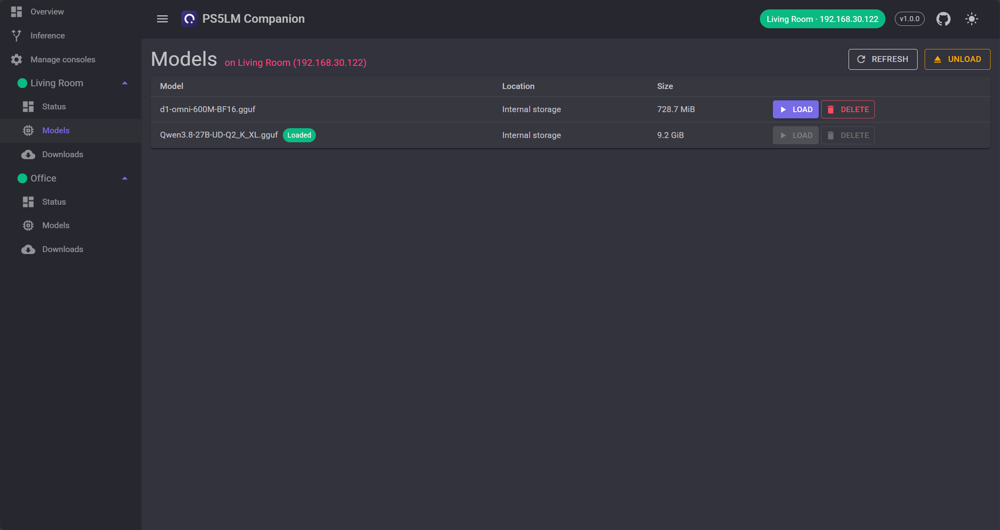
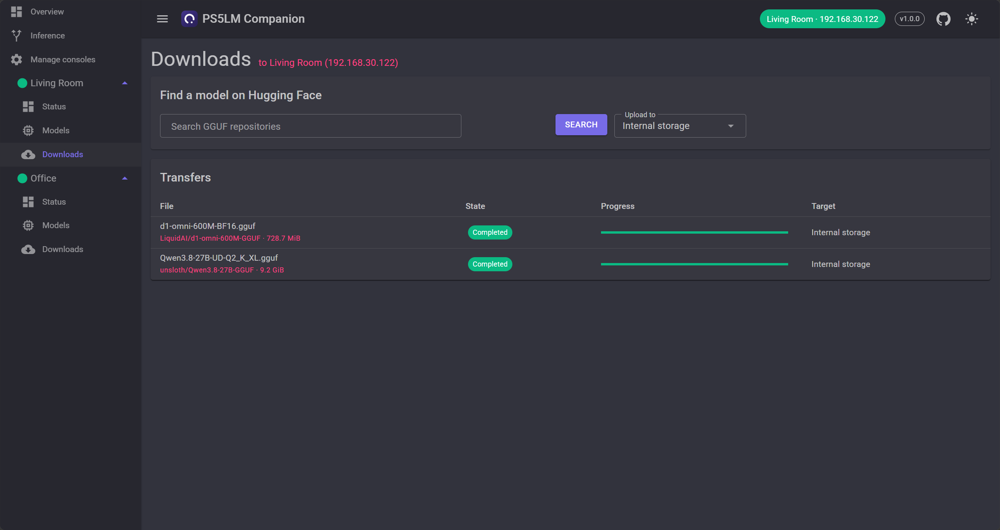
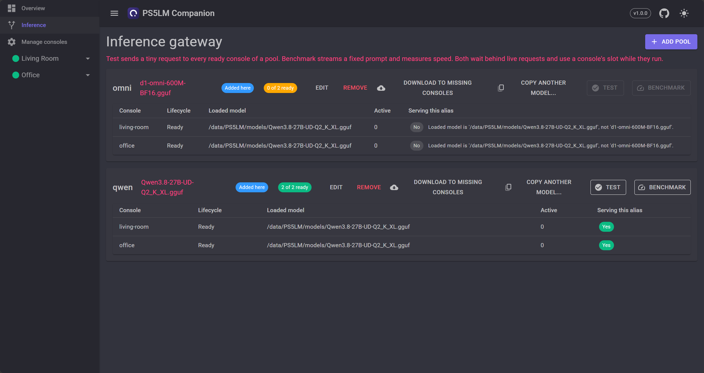

# PS5LM Companion

[](https://github.com/nefarius/PS5LM.Companion/actions/workflows/ci.yml)
[](https://github.com/nefarius/PS5LM.Companion/releases/latest)
[](https://hub.docker.com/r/containinger/ps5lm-companion)
[](LICENSE)
[](https://discord.nefarius.at/)

Headless web dashboard that manages models and monitors a PS5 running PS5LM or PS5LM Plus, from any browser on your network.

> [!NOTE]
> Ahoy, traveler! 👋 This project has been "vibe-coded", meaning that the vast majority of the code has been written with the assistance of AI coding agents. I use my own work in production and value stability and security. Bear in mind, though, that the code you browse might not be an accurate reflection of my personal "style" or taste. The primary goal was to make a useful product, quickly, rather than focus on the development process itself. With that out of the way, if you find it useful, feel free to get inspired by it 😁

## Screenshots

<p align="center">
  
  
  
  
  
  
  <br><sub>Overview, Status, Models, Downloads and Inference.</sub>
</p>

## About

PS5LM and PS5LM Plus only serve their API on port 8081 once a model is on disk and loaded, and their own UI is on the TV.
This companion runs on a PC, NAS or Raspberry Pi and talks to the console over the services those apps already rely on, so it
works before any model exists. It needs no changes to either app.

## Features

- Manages one or more consoles from one dashboard, each with its own status, models and transfer queue.
- Detects PS5LM (`PPSA99575`) and PS5LM Plus (`PPSA99581`) over FTP.
- Lifecycle-aware status: disconnected, app available without a model, loading, ready, generating.
- Lists models on the console; loads and unloads a model through the apps' command files, and deletes one GGUF at a time.
- Downloads GGUF models from Hugging Face on the companion and uploads them to the console.
- Optional inference gateway: one OpenAI/Anthropic-compatible endpoint that load-balances consoles running the same model.
- Checks whether PS5LM or PS5LM Plus is installed and running, and launches it, through the required [nefarius/voidshell](https://github.com/nefarius/voidshell) fork. [websrv](https://github.com/ps5-payload-dev/websrv) is a legacy fallback when that fork is not answering: it cannot report the running title and stops the current app before launching.
- Live telemetry from llama-server (port 8081) and ps5-exporter (port 9100) when they are available.
- Shows whether the required payloads are present. The pinned VoidShell fork is checked on its own port. Payload Manager's process list shows whether kstuff-lite, etaHEN (or onionHEN) and ShadowMountPlus are running. The companion records Payload Manager launches and checks ftpsrv, elfldr and ps5-exporter directly. It launches an installed payload through [PS5 Payload Manager](https://github.com/itsPLK/ps5-payload-manager).

## Support scope

- Companion: Linux, Windows or macOS with .NET 10, or the Docker image (linux/amd64, linux/arm64 via .NET base images).
- Console: jailbroken PS5 running PS5LM or PS5LM Plus with [ftpsrv](https://github.com/ps5-payload-dev/ftpsrv) on port 2121.
- Payload launch needs [PS5 Payload Manager](https://github.com/itsPLK/ps5-payload-manager) on port 8084 and elfldr already listening on port 9021. Payload Manager cannot start elfldr itself.
- App check and launch require the pinned [nefarius/voidshell](https://github.com/nefarius/voidshell) fork on port 7007 (`/api/library`, `/api/stats`, `POST /api/launch`). `setup` installs `v1.1.1-nefarius.4`. That fork reports `running_app` and `firmware` on `/api/stats`. Its `/api/version` string stays `V1.1`, and from `v1.1.1-nefarius.4` on it adds the full SemVer as `semver` (shown in the dependency status; absent on upstream and older fork builds), and the companion still accepts an upstream-shaped stats body. A port of 0 is rejected. Probes use the configured console host only; nothing scans the network for these services. websrv on port 8080 (`/fs`, `/launch?titleId=`) is a legacy fallback used only when the fork does not answer, and a successful fallback does not make the VoidShell dependency healthy. websrv cannot report the running title, and it stops the running app before launching. A truncated title ID of at least 6 characters is matched as a prefix (`PPSA9957` is PS5LM). A VoidShell launch is only queued and is not confirmed; websrv answers 503 when the console refuses to start the title. Either way the app listens on port 8081 only once a model is loaded. REST: `GET /api/consoles/{id}/apps`, `POST /api/consoles/{id}/apps/{ps5lm|ps5lmplus}/launch` and `.../close`. Close writes the `quit` command file the apps poll (over FTP) so they exit through the system's exit path; it is never a kill, and a request the app does not pick up within 20 seconds is withdrawn.
- Not supported: force-killing the PS5LM app, editing the apps' `settings.json`, or detecting a payload that patches the system and leaves no process. Running checks match process names (for example `kstuff.elf`, `etahen.elf`, `onion_daemon.elf`, `shadowmountplus.elf`) from Payload Manager's `/processes_list`.

## Quick start

```sh
dotnet tool restore
version=$(dotnet minver --tag-prefix v)
docker build -f docker/Dockerfile \
  --build-arg MINVERVERSIONOVERRIDE="$version" \
  -t ps5lm-companion .
docker run -p 8080:8080 -v ps5lm-companion:/data \
  -e PS5__Consoles__ps5__Host=192.168.1.50 \
  -e Companion__AccessToken=change-me \
  ps5lm-companion
```

The image build excludes `.git`, so MinVer cannot calculate a version inside Docker. `MINVERVERSIONOVERRIDE` is required. The command above uses the pinned MinVer CLI, which produces the same version as `dotnet build`.

## Configuration

Configuration (environment variables use `__` for nesting). Each console is a section `PS5:Consoles:{id}` where `{id}`
is a stable slug (lowercase letters, digits and hyphens, at most 40 characters); it appears in API routes and keys the
download cache, so do not rename it casually. Consoles can also be added in the dashboard under Manage consoles.
Entries from configuration stay read-only and are marked "from configuration". Consoles added in the dashboard are
stored in `data/consoles.json` and apply without a restart. A stored console whose id is also in configuration is ignored.

| Key | Default | Purpose |
|---|---|---|
| `PS5:Consoles:{id}:Host` | required | Console IP or host name |
| `PS5:Consoles:{id}:DisplayName` | the id | Name shown in the dashboard |
| `PS5:Consoles:{id}:FtpPort` / `LlamaPort` / `ExporterPort` | 2121 / 8081 / 9100 | Service ports |
| `PS5:Consoles:{id}:VoidShellPort` | 7007 | Required port of the pinned nefarius VoidShell fork (not the companion's own port 8080). 1–65535; 0 is rejected. A stored console with port 0 is skipped at startup |
| `PS5:Consoles:{id}:WebsrvPort` | 8080 | Legacy app-launch fallback. 0 disables it. It does not satisfy the VoidShell dependency |
| `PS5:Consoles:{id}:ElfldrPort` | 9021 | elfldr, required before Payload Manager can launch anything |
| `PS5:Consoles:{id}:PayloadManagerUrl` | `http://{Host}:8084` | Payload Manager base URL when it is not on port 8084 of the console |
| `PS5:Consoles:{id}:Variant` | auto | `PS5LM` or `PS5LMPlus`; required when both apps are installed |
| `PS5:Consoles:{id}:PollIntervalSeconds` | 3 | Status refresh interval |
| `PS5:Consoles:{id}:DiscoveryCacheSeconds` / `LoadGraceSeconds` | 30 / 600 | How long an app installation lookup is reused; how long the status stays "loading" after a load request while port 8081 is closed |
| `Companion:AccessToken` | none | Shared secret for the dashboard and `/api` (bearer token or login cookie) |
| `Companion:AllowAnonymous` | false | Allow a network listener without a token (trusted networks only) |
| `Companion:DataDirectory` | `data` | Download cache, transfer list and `consoles.json` (`/data` in the Docker image; mount a volume) |
| `HuggingFace:Token` | none | Access token, only for gated or private repositories |
| `Inference:Pools:{alias}:Model` / `Consoles:{n}` | none | Opt-in [inference gateway](#inference-gateway): the model and the consoles that serve it |
| `Inference:Pools:{alias}:AlternateNames:{n}` | none | Extra `model` names (exact, or a prefix ending in `*`) that reach the pool |
| `Inference:MaxConcurrentPerConsole` / `MaxQueuedRequests` / `QueueTimeoutSeconds` | 1 / 16 / 30 | Requests per console at once; waiting requests across all pools; how long a request waits (see [Inference gateway](#inference-gateway)) |
| `Inference:UpstreamTimeoutSeconds` / `MaxRequestBodyMegabytes` | 900 / 32 | Silence timeout for a forwarded request; body size read to find the model |

The companion refuses to start on a non-loopback address without `Companion:AccessToken`, unless
`Companion:AllowAnonymous` is set. The check covers `urls`/`ASPNETCORE_URLS`, `HTTP_PORTS`, `HTTPS_PORTS` and
`Kestrel:Endpoints`. The token travels in clear text over plain HTTP: put the companion behind a TLS reverse proxy
(the login cookie is marked `Secure` on HTTPS) unless the network is trusted.

## Setting up a fresh console

`setup` is a one-shot command for a console that only runs [PS5 Payload Manager](https://github.com/itsPLK/ps5-payload-manager) on
port 8084. It does not start the dashboard. It upgrades Payload Manager if needed, uploads the payloads (elfldr, kstuff-lite,
OnionHEN, ftpsrv, ShadowMountPlus, VoidShell with its `index.html`, PS5 Web File Manager), enables autoload with a 3 s pause after
kstuff-lite and after OnionHEN, launches them, installs PS5LM or PS5LM Plus for ShadowMountPlus, and prints a report. Downloads
come from a pinned manifest with SHA-256 checksums. Details: [docs/setup.md](docs/setup.md).

```sh
dotnet PS5LM.Companion.App.dll setup --host 192.168.1.50 --variant ps5lmplus
docker run --rm -v ps5lm-companion:/data ps5lm-companion setup --host 192.168.1.50 --variant ps5lm --upgrade-payload-manager
```

Setup installs the required [nefarius/voidshell fork](docs/setup.md#voidshell-fork-build) because upstream v1.1.1 does not start on some firmware (e.g. 13.40). The companion expects that build on port 7007 afterwards. Setup fails if it does not come up.

Exit code 0: nothing failed. 2: a component is not working. 1: bad arguments or manifest.

## Dashboard

Open `http://<companion>:8080/`. The dashboard is Blazor Server with MudBlazor and updates live over its circuit; it
needs no extra configuration. The overview lists every console; with one console, `/` opens that console. Each console has its own pages under `/consoles/{id}`
(status, models, downloads); the address is the selection, so a link opens that console. The drawer lists the same
pages, and the top bar names the console the page shows. Every console keeps being polled in the background.

- **Status** (`/consoles/{id}`): lifecycle, loaded model, generation speed, sensors, drive space, and the payload dependencies. Launch sends an installed payload through Payload Manager. The result confirms the file was transferred. Whether kstuff-lite, etaHEN and ShadowMountPlus are running comes from the process list.
- **Models** (`/consoles/{id}/models`): models on the console with Load, Unload and Delete. Delete removes the selected file; see [Deleting models](docs/model-deletion.md).
- **Downloads** (`/consoles/{id}/downloads`): search Hugging Face, queue a file, watch download and upload progress, cancel.
- **Inference** (`/inference`): add, edit, rename and delete pools, see which consoles can serve each, run the self-test and benchmark, and download a pool's model to consoles that lack it.
- **Manage consoles** (`/settings/consoles`): add, edit and remove consoles, scan the local network for them, and test settings before saving.

With `Companion:AccessToken` set, the browser is sent to `/login` once and keeps an HttpOnly cookie.

## REST API

All routes live under `/api` and need the token when one is configured (`Authorization: Bearer <token>`).

Console-scoped routes live under `/api/consoles/{consoleId}`; an unknown id returns `404`.

| Route | Purpose |
|---|---|
| `GET /api/consoles` | Configured consoles with their lifecycle and whether each came from configuration or was added in the companion |
| `POST /api/consoles` | Add a console. An id that already exists returns `409` |
| `POST /api/consoles/test` | Check unsaved settings: FTP and the installed app, Payload Manager, elfldr, the required VoidShell fork, websrv (skipped when VoidShell answers), ps5-exporter, and llama-server (a closed llama port is not a failure). A VoidShell port of 0 is rejected |
| `POST /api/consoles/discover` | Scan the local IPv4 networks, or `{ "cidr": "192.168.1.0/24" }`, for consoles. A prefix wider than /22 is capped |
| `GET /api/consoles/{consoleId}/settings` | That console's settings and whether they came from configuration |
| `PUT /api/consoles/{consoleId}` | Replace a user console's settings. A configuration console, or one with a queued or running transfer, returns `409` |
| `DELETE /api/consoles/{consoleId}` | Remove a user console. A configuration console, or one with a queued or running transfer, returns `409` |
| `GET /api/consoles/{consoleId}/status` | Normalised console status, including payload dependencies |
| `GET /api/consoles/{consoleId}/dependencies` | Payload installation and health from the latest status check |
| `POST /api/consoles/{consoleId}/dependencies/{id}/launch` | Launch an installed payload by its stable id (`kstuff-lite`, `etahen`, `shadowmountplus`, `ftpsrv`) |
| `GET /api/consoles/{consoleId}/apps` | Whether PS5LM and PS5LM Plus are installed. The required VoidShell fork reports which one is running. With only the websrv fallback the run state is `Unknown`, and the VoidShell dependency stays unhealthy |
| `POST /api/consoles/{consoleId}/apps/{ps5lm\|ps5lmplus}/launch` | Launch the app; `.../close` asks it to quit through its `quit` command file |
| `GET /api/consoles/{consoleId}/models` | Models on the console and the storage locations that accept uploads |
| `POST /api/consoles/{consoleId}/models/load` | `{ "path": "<appPath from models>" }`; only known model paths are accepted |
| `POST /api/consoles/{consoleId}/models/unload` | Unload the current model |
| `DELETE /api/consoles/{consoleId}/models` | `{ "path": "<appPath from models>" }`; deletes that one file |
| `GET /api/consoles/{consoleId}/transfers` | List that console's transfers |
| `POST /api/consoles/{consoleId}/transfers` | Queue `{ "repo", "fileName", "targetRoot"? }` for that console |
| `DELETE /api/consoles/{consoleId}/transfers/{id}` | Cancel a transfer (`404` if it belongs to another console) |
| `GET /api/hub/search?q=` | Search Hugging Face for GGUF repositories (shared) |
| `GET /api/hub/files?repo=owner/name` | List a repository's `.gguf` files (shared) |

Load and unload write the apps' command file and return `202`; the app picks it up within about a second and
restarts its llama-server. A second command while one is unconsumed returns `409`. If the file is never consumed,
the app is probably not running, which the companion cannot tell apart from "running without a model" while
port 8081 is closed.

Delete returns `200` after FTP no longer lists the file. A loaded or loading model, a pending command, or an active
transfer of that file returns `409`. A read-only location returns `400`. The PS5 app keeps its own model list until
it restarts or rescans. Projectors (`mmproj-*.gguf`) are separate files and are deleted one at a time. Details:
[docs/model-deletion.md](docs/model-deletion.md).

Each console has its own transfer queue and runs one transfer at a time; different consoles transfer in parallel. A transfer: download to the cache (resumes after a dropped connection or restart), verify size and
SHA-256, upload as `name.gguf.part`, then rename. The apps never see a half-copied model.

## Inference gateway

Opt-in. The companion can serve the OpenAI, Anthropic and System One APIs on its own port and spread requests over
consoles that run the same model, so clients get one base URL (`http://<companion>:8080/v1`). It is off until a
pool exists. A pool added in the dashboard starts serving without a restart. Forwarding uses [YARP](https://github.com/dotnet/yarp) and streams request and response bodies.

Each public alias (the `model` clients send) names a loaded model and the consoles allowed to serve it:

```sh
-e Inference__Pools__qwen__Model=Qwen3-8B-Q4_K_M.gguf \
-e Inference__Pools__qwen__Consoles__0=living-room \
-e Inference__Pools__qwen__Consoles__1=den
```

PS5LM answers with whatever model is loaded and ignores the `model` field, so the gateway checks instead. A console is a
candidate for an alias only while its lifecycle is `Ready` or `Generating` and the model it reports as loaded matches
`Model`: a bare file name matches that file in any folder, a full path (as in `GET /v1/models` on the console) matches
exactly. A console that is loading, unloaded or has another model is never sent that alias's requests.

**Alternate model names.** Clients that hard-code their own model names (Claude Code sends `claude-*` names) can still
reach a pool: list them under `AlternateNames` (or in the pool editor). An entry is an exact name or a prefix ending in `*`
(`*` alone catches everything else). A request's `model` is matched, ignoring case, first against aliases, then exact
names, then the longest prefix. The same name or prefix cannot belong to two pools. `GET /v1/models` lists only aliases,
and the `X-PS5LM-Pool` response header names the pool that answered.

```sh
-e Inference__Pools__qwen__AlternateNames__0=claude-*
```

| Route | Behaviour |
|---|---|
| `POST /v1/chat/completions`, `/v1/completions`, `/v1/responses`, `/v1/messages`, `/v1/systemone` | Forwarded to one console; JSON and server-sent events are streamed |
| `POST /v1/chat/completions/input_tokens`, `/v1/responses/input_tokens`, `/v1/messages/count_tokens` | Forwarded the same way |
| `GET /v1/models` | The configured aliases with `replicas` and `ready` counts; not forwarded |
| `GET /api/inference/pools` | Per alias and console: lifecycle, loaded model, active requests, and why a console is excluded |
| `POST /api/inference/pools` | Add a pool (`alias`, `model`, `consoles`). A configuration alias returns `409` |
| `PUT /api/inference/pools/{alias}` | Replace a user pool; an optional `alias` in the body renames it. A configuration pool or an existing target alias returns `409` |
| `DELETE /api/inference/pools/{alias}` | Remove a user pool. A request already admitted finishes |
| `GET /api/inference/pools/{alias}/models` | Every model file found on the pool's consoles (projector files named `mmproj*` are left out) and which consoles have it |
| `POST /api/inference/pools/{alias}/test`, `/benchmark`; `GET .../results` | Self-test, benchmark and their latest results (see below) |
| `POST /api/inference/pools/{alias}/sync` | Queue the pool model's download on every pool console that lacks it (see below). `409` when no console has the model or its source is unknown |

Not forwarded: `/props`, `/slots`, `/lora-adapters`, `/metrics`, `/models/*`, the web UI, `/v1/embeddings` and
`/v1/chat/completions/control` (control needs the console that runs the stream). `GET /health` stays the process
check; use `/api/inference/pools` to see whether any console can answer.

Behaviour:

- The gateway reads the top-level `model` of the JSON body to pick the pool, then forwards the original body. A request
  without `model` uses the only pool; with several pools it gets `400`. An unknown alias gets `404`.
- Among ready consoles with a free slot it picks the least busy one, idle before generating, then the least recently used.
  `Inference:MaxConcurrentPerConsole` (default 1, PS5LM starts llama-server with one slot) bounds requests per console.
- When every console is busy a request waits, up to `Inference:MaxQueuedRequests` (16) at once and
  `Inference:QueueTimeoutSeconds` (30); beyond that it gets `429`, and when no console serves the alias or the wait ends, `503`
  with `Retry-After`.
- A request is never retried on another console: once forwarding starts, a failure returns `502` and the client decides.
  Closing the client connection cancels the request on the console and frees its slot.
- `Inference:UpstreamTimeoutSeconds` (900) cancels a request that is silent in both directions; prompt evaluation on a
  console can take minutes. `Inference:MaxRequestBodyMegabytes` (32) caps what is read to find the model.
- The companion's access token is accepted as `Authorization: Bearer` or `x-api-key` and is removed before forwarding.
  Errors under `/v1` are JSON in the OpenAI shape (`/v1/messages`: the Anthropic shape). Responses carry `X-PS5LM-Console`.
- **Self-test:** the **Inference** dashboard page and `POST /api/inference/pools/{alias}/test` send a tiny non-streaming request
  (`max_tokens` 8) to every ready console of the pool and report pass, fail or skipped with timings.
  `POST /api/inference/pools/{alias}/benchmark` streams a fixed prompt (`max_tokens` 64) and reports first-byte and
  first-token time, prompt and generation tokens per second (the console's own `timings` when it sends them) and token counts.
  `GET /api/inference/pools/{alias}/results` returns the latest of each since the companion started. Runs wait behind
  live requests for the console's slot, run one at a time per alias (`409` otherwise), and are not kept across restarts.
  They test each console directly; they do not send traffic through the load balancer.
- In one measured setup, slow first replies came from prompt processing on the console, not the gateway; see [docs/app-arguments.md](docs/app-arguments.md).
- Pools from configuration stay read-only. Pools added in the dashboard are stored in `data/inference-pools.json` and apply without a restart. Each alias needs consoles loaded with the same model; this does not load models.
- **Download to missing consoles:** the button on each pool card (and `POST /api/inference/pools/{alias}/sync`) finds a pool console
  that has the model and learns where it came from: first the finished entries of PS5LM's `downloads.json` in its state folder
  (the PS5LM in-app download list; renamed copies are skipped), then the companion's own completed transfers. It then queues the
  same Hugging Face download on each pool console that lacks the file; progress shows on that console's Downloads page.

## Planned MCP agent runtime

The [MCP agent runtime implementation plan](docs/mcp-agent-runtime-plan.md) describes
delegating coding tasks from Cursor, Codex, and ChatGPT to the inference cluster.
It covers isolated execution workers, durable jobs, shared inference admission,
patch handoff, and NuGet integration choices for this stack. This is a design
proposal; the agent runtime is not implemented.

## Build

Prerequisite: .NET SDK 10.0.100 or newer (`global.json`).

```sh
dotnet restore PS5LM.Companion.slnx
dotnet build PS5LM.Companion.slnx -c Release
dotnet test PS5LM.Companion.slnx -c Release
```

## Support policy

The issue tracker is not a help desk. Include the companion version and logs when reporting a bug.

## Licence

MIT, see [LICENSE](LICENSE). Not affiliated with Sony Interactive Entertainment. "PlayStation" and "PS5" are trademarks of
Sony Interactive Entertainment.

## Sources & 3rd party credits

### Related

- [PS5LM](https://github.com/cobanov/PS5LM)
- [PS5LM Plus](https://github.com/abhi245y/PS5LM-Plus)

### Console services

- [nefarius/voidshell](https://github.com/nefarius/voidshell), the required fork of [amilarajans/voidshell](https://github.com/amilarajans/voidshell)
- [PS5 Payload Manager](https://github.com/itsPLK/ps5-payload-manager)
- [ps5-payload-dev](https://github.com/ps5-payload-dev): [ftpsrv](https://github.com/ps5-payload-dev/ftpsrv), [elfldr](https://github.com/ps5-payload-dev/elfldr) and [websrv](https://github.com/ps5-payload-dev/websrv)
- [kstuff-lite](https://github.com/EchoStretch/kstuff-lite)
- [OnionHEN](https://github.com/aydencharles/onionHEN)
- [ShadowMountPlus](https://github.com/drakmor/ShadowMountPlus)
- [PS5 Web File Manager](https://github.com/owendswang/ps5-web-file-manager)
- [ps5-exporter](https://github.com/Marice/ps5-exporter)

### Dependencies

- [YARP](https://github.com/dotnet/yarp) (inference gateway forwarding)
